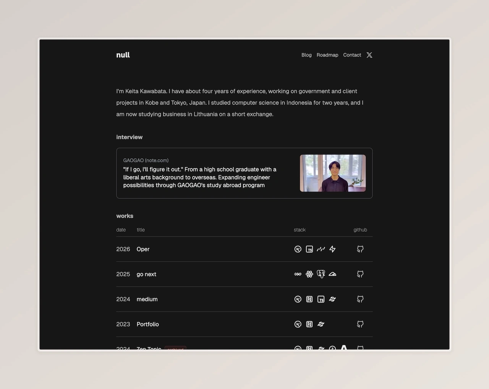
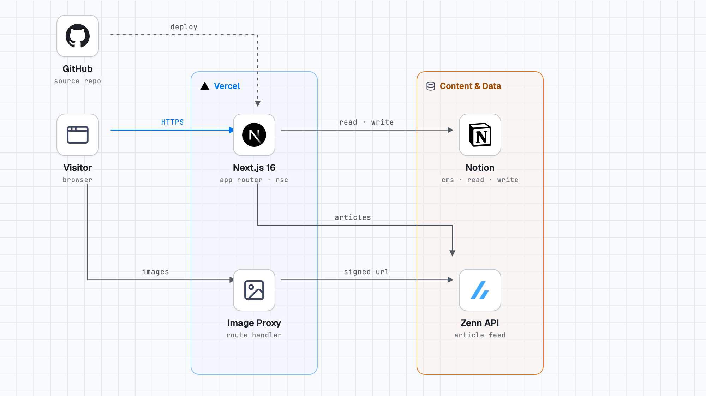

# null — portfolio

My portfolio site. Next.js 16 (App Router, Cache Components), React 19, and Notion as the CMS.

Live: [new-portfolio-two-puce.vercel.app](https://new-portfolio-two-puce.vercel.app)

## What's inside

- **Works** — a table read from a Notion database, with archived projects kept apart
- **Blog** — posts written in Notion, rendered from the block API with a table of contents
- **Zenn** — the latest articles from the Zenn API, next to the blog
- **Contact** — a form that writes into a Notion database through a Server Action

## Stack

Next.js 16.4 · React 19 · TypeScript · Tailwind CSS 4 · Notion API · Zenn API · Zod · pnpm · Vercel

## Architecture

Pages read works, posts and project data from Notion, and article metadata from Zenn. The contact form writes back through a Server Action. Notion returns signed image URLs that expire, so a route handler fetches the current URL and streams the bytes.

## Design notes

**Notion &gt; MDX.** I already write in Notion, so using the API keeps one source of truth; the cost is a custom renderer for 11 block types. An MDX setup still lives on the archive branch.

`"use cache"` **&gt; manual revalidation.** Content changes when I edit Notion, not on a timer. An hour of staleness is fine for a portfolio, so five data functions opt in with `cacheLife("hours")` and a tag.

CI runs `format:check`, `lint`, `typecheck` and `build` on every pull request; Vercel deploys `main`.
